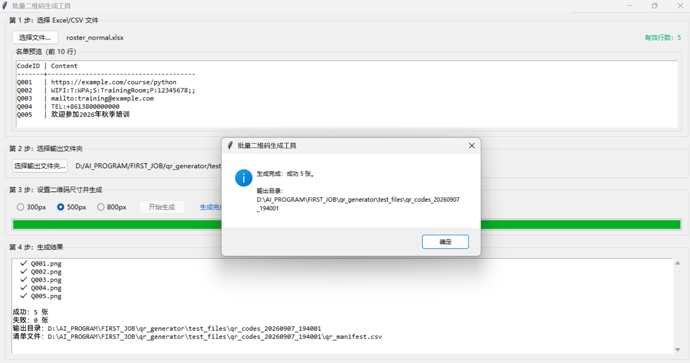

# Batch QR Code Generator

A Windows desktop tool that reads a roster from Excel (`.xlsx`) or CSV, generates hundreds of QR codes in one click, and produces a generation manifest — with strict input validation and all-or-nothing batch safety.

Built for non-technical office users: select file → select output folder → pick size → generate.



## Features

- **Excel & CSV input** — reads the **first worksheet only** of `.xlsx` files (ignores the unreliable "active sheet"); supports UTF-8 / UTF-8 BOM CSV
- **Strict validation with precise errors** — reports the exact file name, Excel row number and reason (missing column, empty field, duplicate ID, illegal characters, wrong encoding, file changed after selection)
- **Duplicate detection** — case-insensitive ID de-duplication (`Q001` and `q001` are treated as duplicates; whitespace trimmed)
- **Tamper protection** — file size, mtime and content hash are re-checked immediately before generation; generation aborts if the input was moved, deleted or modified
- **Pixel-accurate QR rendering** — exact 300 / 500 / 800 px edge length, integer `box_size`, nearest-neighbor scaling, quiet zone preserved, error-correction level M
- **Batch safety** — each run writes to a new timestamped folder; a partially failed batch is fully rolled back, leaving no incomplete results
- **Manifest output** — `qr_manifest.csv` (`CodeID,Content,FileName,Status`) with UTF-8 BOM and standard CSV escaping
- **Simple GUI** — Tkinter interface, no command line needed

## Tech Stack

Python 3.10+ · openpyxl · qrcode · Pillow · Tkinter (standard library)

## Quick Start

```bash
pip install -r requirements.txt
python qr_generator.py
```

Or double-click `启动批量二维码生成工具.bat` on Windows.

## Input Format

| Column | Meaning | Rule |
|---|---|---|
| `CodeID` | QR code identifier | Unique; letters / digits / `_` / `-` only; case-insensitive uniqueness |
| `Content` | QR payload | URL, text, phone number, Wi-Fi config, etc.; kept as-is |

- Header row required; extra columns allowed
- Fully blank rows are skipped; rows with any required field missing raise an error
- Header-only rosters are rejected; maximum 1000 rows

## Output

```
<output>/
└── qr_codes_20260907_142048/
    ├── Q001.png
    ├── Q002.png
    └── qr_manifest.csv
```

If the folder name already exists, `_1`, `_2` … are appended; previous batches and the input file are never modified.

## Test Files

Run `python make_test_files.py` to generate sample rosters (normal, header-only, abnormal, second-sheet) under `test_files/`. Sample output is shown in `example_output/`.
